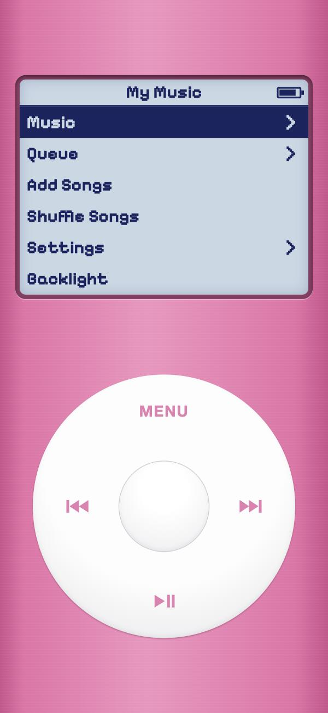
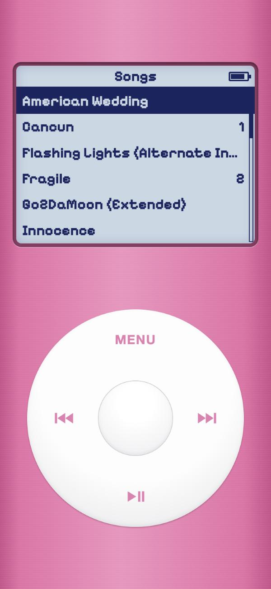
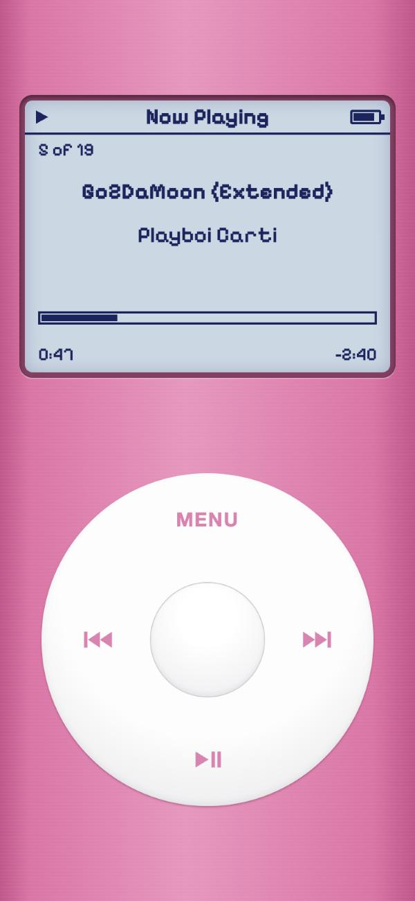
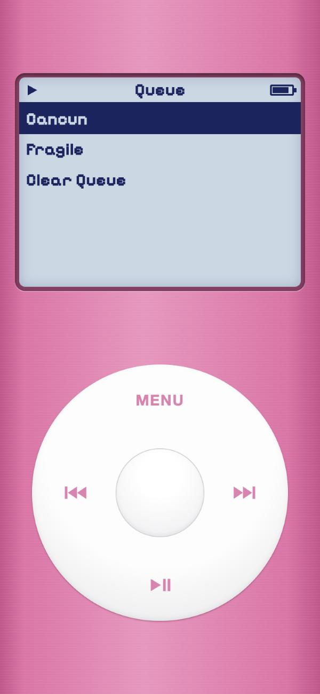

# Pink Mini Player

A retro iPod-like music player for your phone. It runs in the browser, installs to your home screen like an app, and plays MP3s you add from your own device. 

**[Try it here](https://neelabk.github.io/retro-pink-music-player/)** – open the link on your phone.

No music is included. The screenshots show it with a personal library loaded.

  
  
  
  

## What it does

- **Add your own songs** – pick MP3 (or M4A, WAV, AAC) files from your phone. Titles and artists are read from the files' tags.
- **Saved on your device** – songs are stored in the browser on that device, so they are still there next time and work offline. Nothing is uploaded anywhere.
- **Queue** – line up what plays next.
- **Shuffle and repeat** – in Settings.
- **Lock-screen controls** – play, pause, next and previous, where the browser supports them.

## How to use it

| To do this | Do this |
|---|---|
| Scroll a list | Swipe up or down on the screen, or drag your finger around the wheel |
| Select | Tap the row, or press the centre button |
| Go back | Press **MENU** |
| Play / pause | Press the play/pause button at the bottom of the wheel |
| Next / previous song | Press the buttons on the right and left of the wheel |
| Skip forward or back in a song | On Now Playing, drag around the wheel (5 seconds per click) |
| Add a song to the queue | In **Music**, press and hold a song. A number shows its place in line. Hold again to take it out |
| See or edit the queue | **Queue** on the main menu |
| Add songs | **Add Songs** on the main menu |
| Remove a song | **Settings → Remove Songs** |

Volume uses your phone's own volume buttons.

## Put it on your phone

The player is a folder of plain files, so any static web host works.

1. Download this repository (**Code → Download ZIP**) and unzip it.
2. Drag the folder onto [Netlify Drop](https://app.netlify.com/drop), or turn on GitHub Pages for your own copy of the repository.
3. Open the web address you get in Safari on iPhone (or Chrome on Android).
4. Tap **Share → Add to Home Screen**.

It then opens full screen from its own pink icon.

## Good to know

- Songs you add stay on that one device and are removed if you clear the browser's site data.
- On iPhone, music may pause when the screen locks. That is a limit of web apps there.
- There is no build step: `index.html` is the whole app, and `sw.js` makes it work offline.
